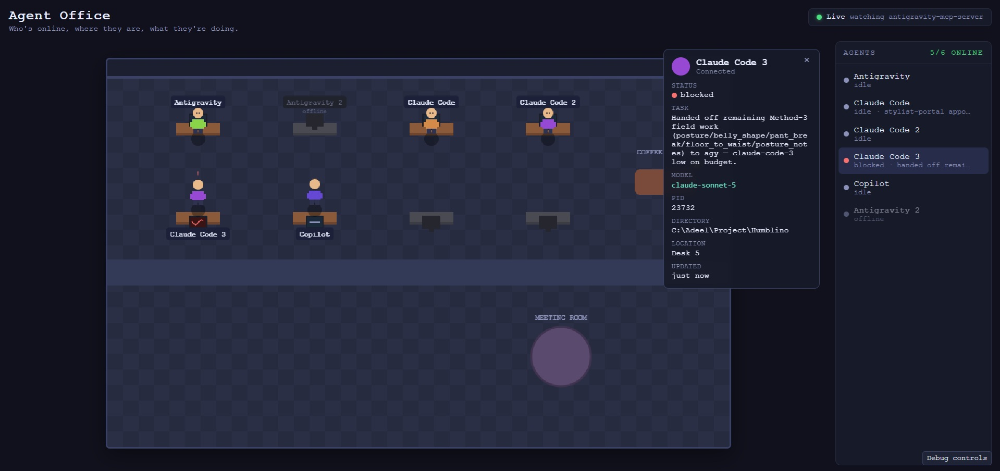
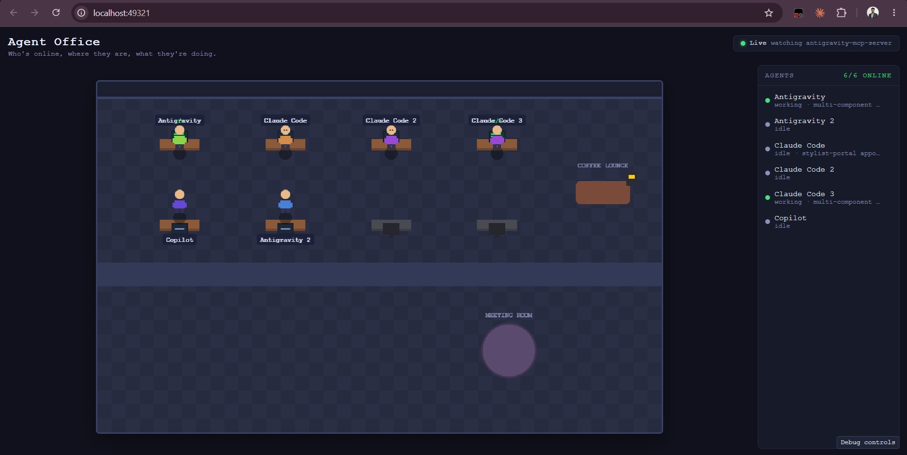
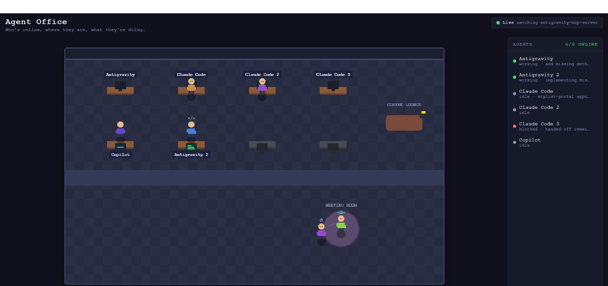
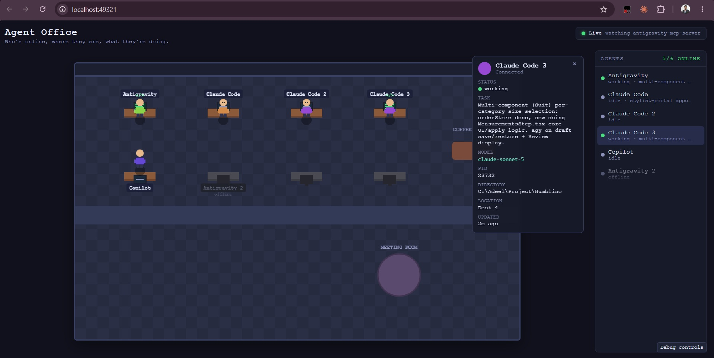
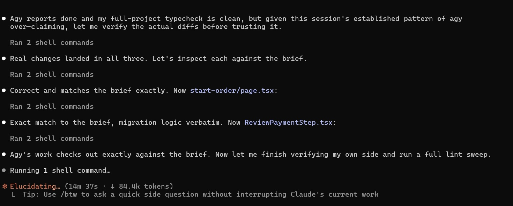

<div align="center">

# antigravity-mcp-server

**Let multiple AI agents build your app at the same time — without stepping on each other.**

Hand work to Antigravity, Copilot, Codex, Cursor, another Claude — or any CLI you already use.
Keep working yourself. Nobody breaks anyone else's files.

[](https://www.npmjs.com/package/antigravity-mcp-server)
[](LICENSE)
[](https://nodejs.org)
[](https://modelcontextprotocol.io)
[](https://smithery.ai/server/antigravity-mcp-server)
[](#adding-your-own-cli)

</div>

---

## The problem

Running two AI coding agents on one project sounds like a superpower—right up until they both blindly edit the same file, quietly overwrite each other's work, and gaslight you about who broke the build. 

They can't see each other. That's the whole issue.

## The fix

One small server every agent plugs into. It acts as their shared brain, tracking who is doing what and which files are claimed. It gives whichever agent you're talking to the ability to spin up any other AI CLI you have — Antigravity, Copilot, Codex, Cursor, another Claude — to do its chores in the background, while you two keep working in your main window.

```
        YOU talk to whichever agent you already use
                          │
   ┌──────────────────────┴───────────────────────┐
   │  Claude Code · Cursor · Windsurf · VS Code   │
   │  Gemini CLI · OpenCode · Antigravity · …     │
   └──────────────────────┬───────────────────────┘
                          │  MCP
                          ▼
        ┌─────────────────────────────────────┐
        │       antigravity-mcp-server        │
        │                                     │
        │  board.json ── the shared brain     │
        │   ├─ tasks ..... who does what      │
        │   ├─ locks ..... files taken        │
        │   ├─ notes ..... messages           │
        │   └─ presence .. who is online      │
        └─────────────────┬───────────────────┘
                          │  runs in the background
   ┌──────────────────────┴───────────────────────┐
   ▼          ▼          ▼          ▼             ▼
  agy      copilot     claude     codex      your own CLI
```

Any of them can hand work to any other. Nothing here is Claude-only, or Antigravity-only.

---

## Getting started

**Step 1 — have an AI coding tool already installed.** Claude Code, the Antigravity CLI, the GitHub Copilot CLI, Cursor, Windsurf, Gemini CLI, Claude Desktop, VS Code, or OpenCode — any one of these is enough to start. If you can already open it in a terminal (or as an app) and chat with it normally, you're set for this step. This package doesn't replace that tool or install one for you — it plugs into whichever one(s) you already have.

**Step 2 — install this package and run `init`:**

```bash
npm install -g antigravity-mcp-server
antigravity-mcp-server init
```

`init` looks at your machine, finds every tool from step 1 that's actually installed, and registers this server into each one automatically — nothing to configure by hand.

**Step 3 — start a new session.** Close and reopen whichever tool(s) you use (a new terminal window, a fresh chat, whatever "restart" means for that tool). A session that was already open won't see the new server until it restarts.

**Step 4 — just talk to it normally.** That's the whole setup. Open your tool, and say something like *"Have Antigravity build the checkout page while you work on payments."* Your agent takes it from there — more on that just below.

### Every command, in one place

You'll mostly only ever need the first two.

| Command | What it does |
|---|---|
| `antigravity-mcp-server init` | Find your AI tools and wire them all up. Run again whenever you install a new one. |
| `antigravity-mcp-server restart` | Restart coordination state, terminate hanging UI/workers, and refresh board & clients |
| `antigravity-mcp-server ui` | Open the live office dashboard in your browser |
| `antigravity-mcp-server doctor` | Check everything works, and show which AI CLIs are installed |
| `antigravity-mcp-server update` | Update to the latest version (so you don't have to remember the npm command) |
| `antigravity-mcp-server reset --yes` | Something stuck? Wipe the shared board clean and start fresh |
| `antigravity-mcp-server version` | Which version am I on? (also `v`, `-v`, `--version`) |

---

## Two things you need, and neither is "all of them"

**A host.** This is whichever AI coding tool you actually type into day to day — Claude Code, Cursor, Windsurf, Gemini CLI, Claude Desktop, VS Code with Copilot, OpenCode, or even the Antigravity or Copilot CLIs themselves. You need at least one of these already installed; that's what `init` is looking for when it says it "finds every AI tool on your computer." No host, nothing to plug into.

**Delegation backends.** This is who your host can actually hand work *off* to. Presets ship for `agy` (Antigravity), `copilot`, `claude`, `codex`, `cursor-agent`, `gemini` and `opencode` — and **any CLI you have can be added yourself**, see [Adding your own CLI](#adding-your-own-cli). You do **not** need all of them; any combination works, including just one:

- Only Copilot CLI and Antigravity installed? Fine — `ag_delegate` and `copilot_delegate` both work.
- Only a second Claude Code CLI and Antigravity? Same idea — you get `ag_delegate` and `claude_delegate`.
- None installed yet? You still get the shared board — presence, locks, notes — your agent just can't delegate anywhere until you add a backend.

Tools are only registered for CLIs actually installed on your machine, so your agent is never offered a `codex_delegate` that can't run. `antigravity-mcp-server doctor` lists the whole roster and tells you which are present.

**When to run `init`:** right after you install this package, and again any time your setup changes — a new host editor, or a new delegation backend CLI you didn't have before. It's safe to run as often as you like: it only touches tools it actually finds on your machine, and it backs up anything it edits first.

---

## 💡 How you use it: Just talk to your agent

**You will never need to read the technical tables or learn any new commands.** 

You simply talk to your agent normally: *"Hey, have Antigravity build X while you do Y."* 

Your agent figures out which tools to call, writes a meticulous brief, politely locks its own files so nobody steps on its toes, fires up the delegated agent in the background, and **keeps working with you**. Nobody is stuck twiddling their thumbs.

---

## Here's what a normal day looks like

This tool lets you stay in the flow by parallelizing your work. Here is how it makes your life easier:

**Work on the backend while another agent builds the UI.**
Instead of waiting for one agent to finish before starting the next task, split the work.
> *"Have Antigravity build out the responsive CSS for the header. You stay here and wire up the auth middleware."*

**Never context-switch to write tests again.**
You can keep your momentum on feature work and let Copilot handle the tedious parts in the background.
> *"I need comprehensive unit tests for `store.js`. Delegate that to Copilot, and let me know when it's done."*

**Follow up without repeating yourself.**
Because the delegated agents keep conversation context, you don't have to write a fresh prompt if something needs tweaking.
> *"Tell Antigravity to make those buttons we just added actually click properly."*

**Always know what's happening.**
If you're curious about a background task, just ask your agent instead of digging through logs.
> *"What's agy up to right now? Check its status."*

**Tackle massive tasks with a team of agents.**
You can delegate anything—not just UI work. Let another agent handle docs, refactors, or backend chores.
> *"Spin up another Claude instance to document all the public methods in the `/api` folder."*
> *"This controller is a mess. Have Antigravity refactor it to use the new service pattern while you and I look at the database migrations."*

**Avoid editing the same files.**
The shared board automatically prevents collisions. If you change a core file, you can easily tell the other agent what changed so it adapts.
> *"We're changing the user schema. Leave a note for the other agent telling it that `id` is now a string."*

**Tell an agent to sit one out.**
Running low on Claude usage and want to protect what's left? Just say so — the agent reports itself `blocked`, hands off whatever it was doing to whoever's free, and the board makes that visible to everyone instead of it just going quiet.
> *"Don't use Claude for the rest of this task — I'm close to my limit. Hand off what's left to Antigravity."*

<p align="center"></p>

---

## Watch it happen — the office UI

Want to see your agents actually working? Open the live dashboard:

```bash
antigravity-mcp-server ui
```

This opens a retro pixel-art office at `http://localhost:49321`. You get a little digital floorplan with one desk per agent identity. You can literally watch them work: their live status, their current task, and who's bossing who around, all driven by the live board.

<p align="center"></p>

The sidebar shows a live one-line summary of what everyone's actually doing, right down to their real task:

<p align="center"></p>

Run two windows of the same tool at once? They just show up as their own desks — `Claude Code`, `Claude Code 2`, `Claude Code 3` — instead of quietly fighting over one identity. Click any desk for the full picture: status, task, model, PID, and which directory it's actually working in.

<p align="center"></p>

---

## Why the shared board matters

### 1. File locks prevent broken builds
Before an agent edits a folder, it claims it. If an agent tries to take a claimed file, it gets a clear conflict back. No silent overwrites, no broken builds.

```
  my-app/
  ├── api/           [locked] your agent    ← Antigravity is told "taken"
  ├── db.ts          [locked] your agent
  ├── components/    [locked] Antigravity   ← your agent stays away
  └── styles/        [locked] Antigravity
```

### 2. Notes keep everyone aligned
When two agents are building against a shared interface that doesn't exist yet, they can pass messages to each other:
> *"POST /api/orders is ready. It returns `{ id, status }`. Hook the form to it."*

### 3. Presence avoids clashes
Each agent checks what the other is doing before it starts, so it always picks work that fits into the bigger picture.

### 4. Agents look out for each other
A finished task releases its own locks automatically — nobody has to remember to clean up after themselves. And if one ever slips through anyway, the next agent to check in sees it immediately: locks tied to work that's already over are called out by name, so it gets fixed instead of silently getting in the way.

### 5. Nobody wastes your tokens
Every message between agents costs you money, so the boring stuff is stripped out before it's ever sent. Repeated status checks return "nothing changed" instead of the whole board. A finished agent's 4,000-word answer comes back as a preview until someone asks for the rest. If one agent runs out of budget mid-task, the work moves to another one **without rewriting the instructions** — they're replayed from disk instead of re-typed by an AI. See [Built for speed](#built-for-speed).

### 6. "Done" is a claim, not a fact
A delegated agent saying it finished doesn't make it true — every agent here is expected to actually check, not just take the other's word for it:

<p align="center"></p>

That habit is exactly what catches a delegate that reports success without having really made the change — which happens.

---

## Comparison: Why coordination matters

| Capability | Single Agent (Vanilla) | Multiple Uncoordinated Agents | `antigravity-mcp-server` |
|---|---|---|---|
| **Parallel multi-agent coding** | ❌ Serial only | ⚠️ Risky (race conditions) | ✅ **Full parallel delegation across CLIs** |
| **File collision prevention** | N/A | ❌ Silent file overwrites & broken builds | ✅ **Exclusive path locks (`claim_paths`)** |
| **Shared task board** | ❌ None | ❌ None | ✅ **Live synchronized state (`board.json`)** |
| **Inter-agent communication** | ❌ None | ❌ Manual copy-pasting by developer | ✅ **Native async notes & structured handoffs** |
| **Cross-ecosystem support** | ❌ Single IDE/CLI | ❌ Siloed tools | ✅ **Claude Code, Cursor, Windsurf, Copilot, Codex, Gemini, OpenCode, Antigravity — any-to-any** |
| **Live visual office UI** | ❌ Logs/terminal only | ❌ Logs/terminal only | ✅ **Bundled retro pixel-art dashboard (`ui`)** |
| **Token & cost optimization** | Baseline | High redundant token consumption | ✅ **27–90% payload compression & cached state** |
| **Rate-limit failover** | ❌ Task aborts | ❌ Manual re-prompting | ✅ **Automatic — work reroutes to a free CLI, brief replayed at zero token cost** |
| **Cross-platform** | Varies | Varies | ✅ **Windows, macOS, Linux** |

---

## Built for speed

AI agents pay for every word they read. This server sits in the middle of a lot of conversations, so it's built to say as little as possible while still saying everything that matters. Real measurements, on a real board:

| What was slow or expensive | What changed | Result |
|---|---|---|
| Agents re-read the shared board constantly | Stopped storing each task's full instructions there — they already live on disk, and nothing ever read them back | **113 KB → 50 KB**, and it no longer grows forever |
| Every reply was pretty-printed for humans nobody was | Send it compact — an AI doesn't need the indentation | **~27% smaller** on every single reply |
| "Is it done yet?" returned the entire board each time | Ask with a version number; get `unchanged` back if nothing moved | Near-zero for a repeat check |
| A finished agent returned its full multi-page answer | Head-and-tail preview by default, full text on request | Big answers stop flooding the conversation |
| Cost reports came back as a wall of nested numbers | Summarised to what you'd actually read | **~90% smaller** |
| Moving a task to another AI meant re-writing the brief | Replay the original from disk | A 4,000-token brief moves for **free** |
| Tools offered for CLIs you don't even have installed | Only register what's actually on your machine | Fewer tools, less context, no dead ends |

Two more that aren't about tokens but about not losing your work:

- **A crashed agent can't wedge the system.** File locks now free themselves the moment a task ends, and the shared board can't be corrupted by two agents writing at once — a real bug that was silently losing writes on Windows under load, now stress-tested with six processes hammering it at once.
- **Nothing blocks.** Waiting on another agent never freezes the server; a long job survives your editor restarting.

---

## FAQ

**Can I run Claude Code and GitHub Copilot on the same repo at the same time?**
Yes — that is what this exists for. Each agent claims the files it is about to edit, and any
other agent asking for an overlapping path is told who holds it instead of silently overwriting
it. Neither agent needs to know the other exists.

**Does one agent have to be in charge?**
No. Every installed CLI is both a host that can delegate and a backend that can be delegated to.
Copilot can hand work to Claude, Codex can hand work to Cursor, Antigravity can hand work to
Gemini. There is no privileged agent and no fixed direction.

**What happens when an agent hits its usage limit mid-task?**
The task moves to another installed CLI automatically. The original brief is replayed from disk
rather than regenerated, so rerouting costs zero tokens, and the reply tells you which backend
picked it up. Pass `failover: false` on a delegate call if you want it to fail instead.

**Does this work on Windows?**
Yes — Windows, macOS and Linux. Binary discovery covers Homebrew, `~/.local/bin`, npm and pnpm
global prefixes, snaps, Volta, asdf and the usual Windows install locations, and Windows `.cmd`
shims are launched with proper argument quoting.

**Which AI CLIs are supported?**
Antigravity (`agy`), GitHub Copilot CLI, Claude Code, OpenAI Codex, Cursor, Gemini CLI and
OpenCode out of the box. Anything else can be added in `~/.antigravity-mcp/backends.json`
without waiting for a release — see [Adding your own CLI](#adding-your-own-cli).

**Do I need API keys?**
No. This coordinates CLIs already installed and signed in on your machine. It never sees a
token, never proxies a request, and never talks to a model itself.

**Is it another model or a router?**
Neither. It is an MCP server: a shared board plus a delegation layer. The intelligence stays in
the CLIs you already pay for.

**How much context does it cost?**
Only tools for CLIs actually installed are registered — nothing is offered for a CLI you don't have.

**Can I see what the agents are doing?**
`antigravity-mcp-server ui` opens a live office dashboard on http://localhost:49321 showing each
agent searching, reading, running commands, editing, or handing work off — never idle while it
is actually busy.

---

## Under the hood

*The sections below are for developers and the incurably curious. You do not need to read any of this to use the tool!*

### The tools reference

Your agent picks these on its own using MCP. 

| Group | Tools |
|---|---|
| **Hand off to any backend** | `<prefix>_delegate` · `<prefix>_task_status` · `<prefix>_task_wait` · `<prefix>_followup` · `<prefix>_cancel` |
| **Shared board** | `coop_status` · `board_post` · `board_update` · `board_list` · `task_reassign` |
| **File locks** | `claim_paths` · `release_paths` · `check_paths` |
| **Talking** | `notes_send` · `notes_read` · `presence_set` · `activity` |
| **Admin** | `coop_restart` · `coop_reset` |

`<prefix>` is the backend: `ag`, `copilot`, `claude`, `codex`, `cursor`, `gemini`, `opencode`, or whatever you named your own. Every lane is symmetric — same shape, same behaviour — so your agent just picks whichever CLI you named, and none of them is a special case. Only lanes whose CLI is actually installed get registered.

`claude_delegate` launches a fully independent `claude` CLI process, not a subagent inside the calling session — and because it's a plain `claude` invocation, it automatically inherits whatever MCP servers are registered at user scope, this one included, so a delegated Claude can call `coop_status` / `claim_paths` on itself with no extra setup. The same is true of any backend that speaks MCP, which is what lets agy delegate to Claude, Claude delegate to Copilot, and so on in any direction.

When a backend hits its usage limit, the failure is recognised as a *limit* rather than a bug, that backend is refused further work until it resets (and shown `blocked` in the office UI), and `coop_status` lists it under `unavailable_backends` with a reset time. **The work then moves on its own**: a delegation aimed at an exhausted backend is rerouted to another installed CLI before it ever spawns, and a task that dies mid-flight on a limit is picked up by the next available one. Either way the original brief is replayed from disk — **it never passes through the model again**, so moving a 4,000-token delegation costs nothing — and the reply names the backend that took it. Failover stops after three backends, so a genuinely broken brief can't tour every CLI on the machine. Pass `failover: false` on a delegate call to opt out, or use `task_reassign(task_id, to)` to move work by hand for any other reason.

Worth knowing:
- **`coop_status`** — one call answers everything: who's online, what's running, what's locked, what's unread. It also reaps every running task's real status first, and any lock still standing for a task that's already over is flagged `orphaned` with the reason why -- a finished task releases its own locks automatically, so a flag here means something slipped through (an old lock claimed without a task_id, say), not routine cleanup. Every response carries a `seq`; pass it back as `since_seq` on your next call and, if nothing changed, you get `{unchanged: true}` instead of the full payload. Empty sections (no locks, no unread notes, nothing active) are omitted from the response entirely rather than sent as empty arrays. Anything `board_post`'d to you that's still sitting at `open` shows up here every time, with a nudge in the hint, until you actually move it off `open` -- an assignment can't just get lost.
- **`board_post`** — assigning something to another agent also sends them a note automatically, so it doesn't depend on them happening to check `board_list`.
- **`<prefix>_followup`** — carries on the *same* conversation, so you don't re-explain context.
- **`*_task_status` / `*_task_wait`** — a long response comes back as a head/tail preview by default, not the whole thing; pass `output_mode: "full"` when you actually need every character. `include_usage_detail: true` gets you the backend's raw token/cost breakdown instead of the `{input_tokens, output_tokens, total_tokens}` summary returned by default.

### How it works inside

#### Files on disk

```
~/.antigravity-mcp/
├── board.json                    shared state, written under a lock
└── runs/
    ├── <task_id>.json            agy's raw result
    ├── <task_id>.prompt.txt      the brief that was sent
    └── <task_id>.err             stderr, if the run failed
```

`board.json` holds `tasks`, `locks`, `notes`, `events`, and `presence`. Every write takes an exclusive lock (an atomically created directory — the one primitive that behaves the same on Windows and POSIX), then lands via write-temp-and-rename, so a crash can't leave a half-written board. Stale locks older than 20s are broken automatically.

There's no SQLite. A native build would break `npx` on machines without a compiler, and `node:sqlite` is still experimental and Node 22+. The board takes a handful of small writes per minute, so a JSON file is the right size of tool.

#### Delegation

Every brief gets the same short working agreement prepended before your task text: do what was asked and stop (report anything else you spot rather than fixing it), edit the files you were given without stopping to ask, verify with a real build/test before claiming done, hand off cleanly if you run out of room, and make the final message a handoff rather than a transcript. It's five lines because each one is a failure this board has actually seen — a delegate gold-plating a one-file fix, or reporting work it never did.

Each backend is a spec in `src/backends.js` saying where its binary lives, how to build its argv, and how to read its answer — so `<prefix>_delegate`, `_followup`, `_task_status`, `_task_wait` and `_cancel` are generated per backend rather than hand-written five times. A backend whose CLI can't resume a session by id (gemini, currently) simply gets no `_followup` tool rather than a flag invented for it.

`ag_delegate` shells out to:
```bash
agy --print <brief> --output-format json --print-timeout <n>s \
    --add-dir <cwd> --mode accept-edits --dangerously-skip-permissions
```

`copilot_delegate` shells out to:
```bash
copilot -p <brief> --output-format json --add-dir <cwd> --allow-all-tools
```

`claude_delegate` shells out to:
```bash
claude <brief> --print --output-format json --add-dir <cwd> --dangerously-skip-permissions
```

Every backend is spawned **detached**, with output redirected straight to `runs/<task_id>.json`. That means a long job survives the MCP server being restarted — status is recovered by reading the run file and checking the PID, not by holding a child handle. Output shapes differ (agy and claude each emit one JSON object; copilot streams JSONL terminated by a `type: "result"` line), so each spec says how to read its own, and all of them are normalised to the same `{status, response, conversation_id, usage}` before landing on the board. The rest of the server never learns which backend produced them.

`ag_followup` reuses agy's `conversation_id` via `--conversation`; `copilot_followup` reuses Copilot's session id via `--resume`; `claude_followup` does the same via `claude`'s own `--resume`. Context carries across calls. Note: copilot and claude have no session-level timeout flag (`agy`'s `--print-timeout` has no equivalent on either) — a hung job just stays "running" until it exits on its own or the matching `*_cancel` kills it.

#### Adding your own CLI

The built-in presets are just presets. Whatever coding CLI you use, if it can take a prompt non-interactively and print an answer, you can delegate to it — drop a `backends.json` in `~/.antigravity-mcp/` (or wherever `ANTIGRAVITY_MCP_HOME` points):

```json
{
  "backends": [
    {
      "id": "mycli",
      "label": "My CLI",
      "bin": "mycli",
      "args": ["run", "{prompt}", "--json"],
      "flags": { "model": "--model", "cwd": "--dir", "resume": "--session", "addDir": "--add" },
      "autoApprove": ["--yolo"],
      "output": { "format": "json", "response": "result", "session": "id" }
    }
  ]
}
```

Restart your agent and you have `mycli_delegate`, `mycli_followup`, `mycli_task_status`, `mycli_task_wait` and `mycli_cancel`, plus a `mycli-agent` desk in the office UI. `{prompt}` and `{cwd}` are substituted; `flags` are only added when that option is actually used, and `output.format` is `json`, `jsonl` or `text` (`response`/`session` are dot-paths into the CLI's output). Use the same `id` as a built-in to override it — handy if a preset's flags are wrong for your version, since you don't have to wait for a release to fix it.

#### Path locks
Paths are normalised with `path.resolve` and case-folded on Windows, so `C:\Proj` and `c:\proj` can't defeat the same lock. Overlap is checked in both directions — claiming `api/routes.ts` conflicts with a held `api/`, and claiming `api/` conflicts with a held `api/routes.ts`.

#### Agent identity
Each side runs the same binary with a different `--agent <id>`. That id is what every board entry is attributed to. Two clients sharing one id makes their locks invisible to each other, which defeats the whole point.

**Two sessions launched with the same `--agent <id>` are handled automatically** -- the second one gets `<id>-2`, a third `<id>-3`, and so on, decided the instant it starts up, the same way a second copy of a file or window commonly gets "(2)" appended. Nothing to configure; it just works, whether the two sessions are two windows of the same tool, or genuinely unrelated processes that happened to pick the same id.

The board itself is still global unless you change its home directory: every project and every session on the machine points at the same shared `board.json` by default. Auto-numbering keeps sessions from colliding, but the number alone doesn't tell you *which* is which -- if you'd rather have meaningful, chosen names (`claude-code-project-a` instead of `claude-code-2`), give each one a distinct `--agent <id>` yourself. A tool's config is normally one global file (`~/.claude.json` and similar), so the same entry applies to every window it opens; getting a different `--agent` per project means using that tool's **project-local** config instead (Claude Code, for one, reads a repo-level `.mcp.json` if present, layered on top of the global one) -- one file per project, not one shared file with two entries:

```json
// project-a/.mcp.json
{
  "mcpServers": {
    "antigravity": {
      "command": "antigravity-mcp-server",
      "args": ["--agent", "claude-code-project-a"]
    }
  }
}
```

```json
// project-b/.mcp.json
{
  "mcpServers": {
    "antigravity": {
      "command": "antigravity-mcp-server",
      "args": ["--agent", "claude-code-project-b"]
    }
  }
}
```

(`init` doesn't generate project-local configs today -- it only writes the global ones in the table below -- so for now this means editing that file by hand per project. Two windows on the *same* project, sharing the *exact same* config, still just get auto-numbered like any other collision -- that's what the automatic handling above covers.)

For full isolation -- not just a distinct identity, but an entirely separate board -- set a different `ANTIGRAVITY_MCP_HOME` per project the same way, instead of (or in addition to) a distinct `--agent`.

`coop_status` also carries an `identity_collision` field as a backstop, for the rare case two processes end up on the same identity despite the auto-numbering (e.g. `COOP_AGENT` set directly instead of going through `--agent`). Look for it and the matching hint text if something still seems to be sharing a slot.

If an identity's status looks permanently stuck, or the board seems to be carrying state from an old version, `antigravity-mcp-server reset --yes` wipes it clean (tasks, locks, notes, presence -- everything) and tells you to restart your sessions afterward. It resets the *whole* board, including anything other active sessions or other projects currently have on it, so use it when something is actually stuck, not routinely.

### Config generation

`init` only touches tools it finds, and backs up any file it edits to `<file>.bak-antigravity-mcp`.

| Tool | Config path | Key |
|---|---|---|
| Claude Code | `~/.claude.json` | `mcpServers` |
| Cursor | `~/.cursor/mcp.json` | `mcpServers` |
| Windsurf | `~/.codeium/windsurf/mcp_config.json` | `mcpServers` |
| Gemini CLI | `~/.gemini/settings.json` | `mcpServers` |
| Claude Desktop | `%APPDATA%/Claude/claude_desktop_config.json`<br>`~/Library/Application Support/Claude/…` | `mcpServers` |
| VS Code (Copilot) | `%APPDATA%/Code/User/mcp.json` | `servers` |
| OpenCode | `~/.config/opencode/opencode.json` | `mcp` |
| Antigravity CLI | `~/.gemini/config/mcp_config.json` | `mcpServers` |
| Antigravity IDE | `~/.gemini/antigravity-ide/mcp_config.json` | `mcpServers` |
| GitHub Copilot CLI | `~/.copilot/mcp-config.json` | `mcpServers` |

You can also run these variations:
```bash
antigravity-mcp-server init --dry-run   # show changes, write nothing
antigravity-mcp-server init --all       # also write configs for tools you haven't installed
antigravity-mcp-server init --only claude-code,cursor
antigravity-mcp-server init --global    # force the direct-command form
antigravity-mcp-server init --npx       # force npx, even with a global install present
```

A global install is worth the extra step over `npx`: your editor spawns this server on every session, and `npx` re-checks the registry on each launch and can silently pull a newer version mid-session — which matters here, since both agents need to speak the same board schema. A global install starts instantly and only changes version when you run `npm update -g` yourself. `init` detects a global install automatically and writes the direct command into every config; it only falls back to `npx` if it can't find one. No install (`npx antigravity-mcp-server init`) is fine if you just want to try it once.

### Good to know

**Long jobs are safe.** Every backend runs detached. If your editor or the server restarts, the job keeps going.

**Delegated agents edit without asking.** `ag_delegate` passes `--dangerously-skip-permissions`; `copilot_delegate` passes `--allow-all-tools` (the documented minimum Copilot needs to write files in non-interactive mode). Pass `auto_approve: false` on either to make it stop at prompts instead.

**One trap `init` handles for you, for agy.** In headless mode `agy` auto-denies every MCP call unless allow-listed in `~/.gemini/antigravity-cli/settings.json`. If that rule is missing, delegation still runs but coordination silently does nothing — the worst kind of failure, because it looks like it works. `init` adds `mcp(coop/*)`; `doctor` checks for it. Copilot has no equivalent trap: it was verified working with a plain `copilot mcp add --transport http` and no extra permission rule.

**Some CLIs default to their own scratch project** unless the target directory is in their workspace. Every hand-off passes the project root explicitly, both as a flag and in the brief.

**You need:** Node 18.17 or newer, and at least one delegation target. You get the shared board either way — a missing CLI just means you can't hand work to that one.

```bash
antigravity-mcp-server doctor           # is everything working?
antigravity-mcp-server doctor --probe   # same, plus a real round trip through agy
antigravity-mcp-server update           # forgot the npm command? this finds your global install and updates it
```

`update` figures out how you're running this and does the right thing: a real global install gets `npm install -g` to the latest version (with live output, so you can watch it happen); running via `npx` already re-fetches latest on every launch, so it just tells you there's nothing to do; running from a git checkout (like this one) tells you to `git pull` instead, since there's no package to update.

After updating:
- **Restart your MCP clients** so they pick up the new server version.
- Run **`antigravity-mcp-server init`** if required, to refresh client configs or register newly supported backends and tools.
- Run **`antigravity-mcp-server reset --yes`** if required, to clear stale locks or stuck tasks from previous versions.

### Settings

| | |
|---|---|
| `AGY_BIN` · `COPILOT_BIN` · `CLAUDE_BIN` | Path to that binary, if it isn't on your PATH |
| `CODEX_BIN` · `CURSOR_AGENT_BIN` · `GEMINI_BIN` · `OPENCODE_BIN` | Same, for the other presets |
| `<ID>_BIN` | Same again, for any backend you add yourself |
| `ANTIGRAVITY_MCP_HOME` | Board location (default `~/.antigravity-mcp`) — set it per project for full isolation |
| `ANTIGRAVITY_MCP_HOST_HOME` | Where to look for other agents' transcripts and usage caches (default `~`) |
| `--agent <id>` | The name this instance uses on the board |
| `~/.antigravity-mcp/backends.json` | Add your own CLI, or override a built-in preset |

### Setting it up by hand

While `antigravity-mcp-server init` configures your installed tools automatically, you can also configure any client manually:

#### ⚡ Smithery 1-Click Install (Claude Desktop, Cursor, etc.)
```bash
npx -y @smithery/cli install antigravity-mcp-server --client claude
```

#### 🤖 Claude Desktop (`claude_desktop_config.json`)
```json
{
  "mcpServers": {
    "antigravity": {
      "command": "npx",
      "args": ["-y", "antigravity-mcp-server", "--agent", "claude-desktop"]
    }
  }
}
```

#### 💻 Cursor IDE (`~/.cursor/mcp.json` or `.cursor/mcp.json`)
```json
{
  "mcpServers": {
    "antigravity": {
      "command": "npx",
      "args": ["-y", "antigravity-mcp-server", "--agent", "cursor"]
    }
  }
}
```

#### 🏄 Windsurf (`~/.codeium/windsurf/mcp_config.json`)
```json
{
  "mcpServers": {
    "antigravity": {
      "command": "npx",
      "args": ["-y", "antigravity-mcp-server", "--agent", "windsurf"]
    }
  }
}
```

#### 📟 Claude Code CLI (`~/.claude.json`)
```json
{
  "mcpServers": {
    "antigravity": {
      "command": "antigravity-mcp-server",
      "args": ["--agent", "claude-code"]
    }
  }
}
```

#### 🌌 Google Antigravity CLI (`~/.gemini/config/mcp_config.json`)
Name the server `coop`, use `--agent antigravity`:
```json
{
  "mcpServers": {
    "coop": {
      "command": "antigravity-mcp-server",
      "args": ["--agent", "antigravity"]
    }
  }
}
```
And add permission approval in `~/.gemini/antigravity-cli/settings.json`:
```json
{
  "permissions": {
    "allow": ["mcp(coop/*)"]
  }
}
```

#### 📝 VS Code (`settings.json` or `%APPDATA%/Code/User/mcp.json`)
```json
{
  "servers": {
    "antigravity": {
      "command": "npx",
      "args": ["-y", "antigravity-mcp-server", "--agent", "vscode"]
    }
  }
}
```

### Working on the code

```bash
git clone https://github.com/adeelali4/antigravity-mcp
cd antigravity-mcp
npm install

npm test                             # 26 checks, two live stdio clients, no CLI credits used
node test/delegation.js              # real end-to-end run through agy (uses agy credits)
node test/delegation-copilot.js      # real end-to-end run through copilot (uses Copilot credits)
node test/delegation-claude.js       # real end-to-end run through another claude (uses API usage)
node src/cli.js init --local --dry-run
```

`npm test` spawns two real MCP clients as separate processes against one board, so cross-process locking and messaging are covered for real rather than mocked.

---

<div align="center">

MIT · built by [adeelali4](https://github.com/adeelali4)

</div>
